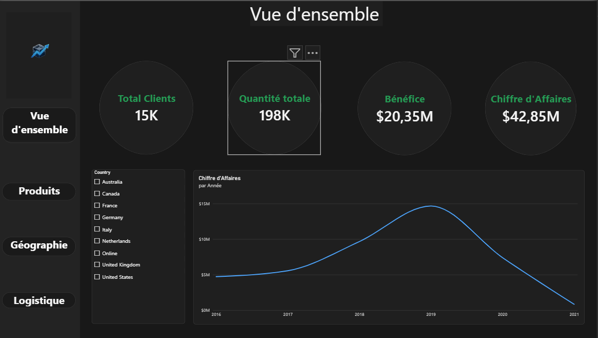
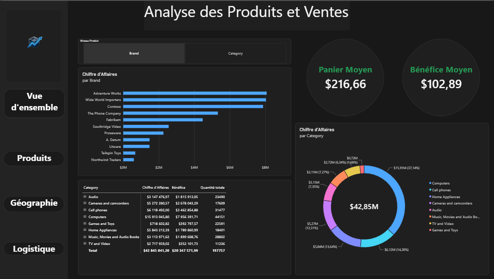
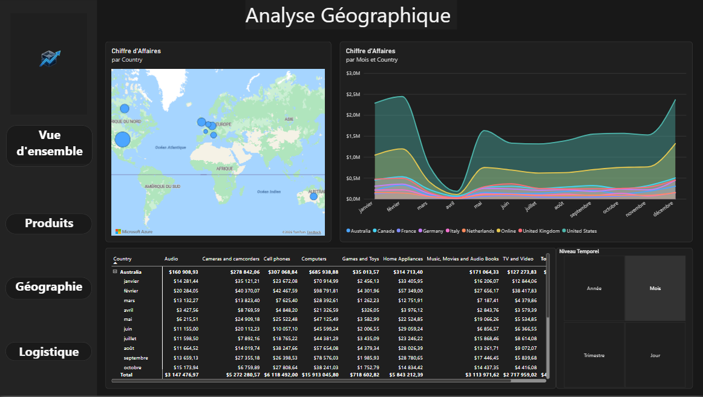
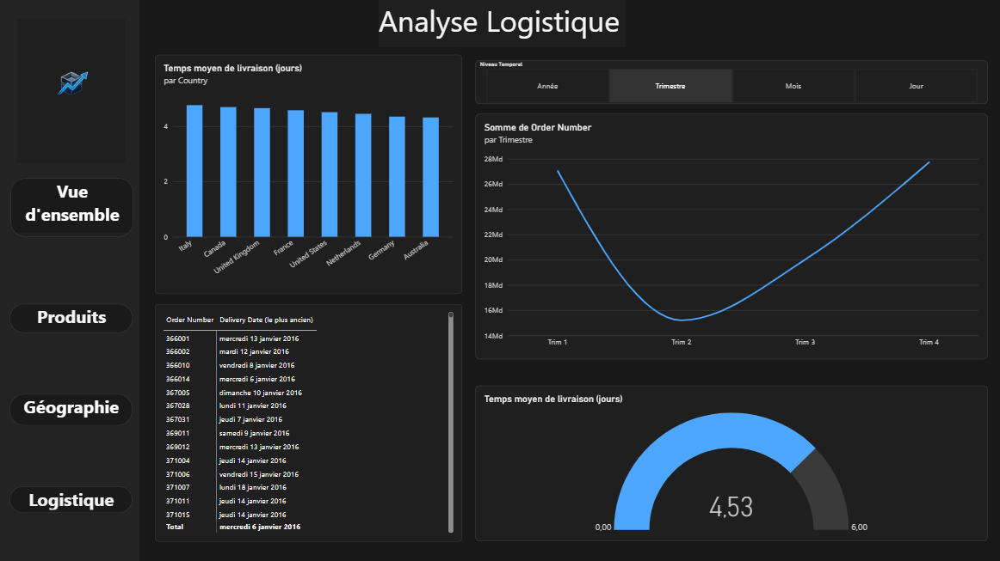

# Retail Text-to-DAX AI Agent

## À propos du projet
Ce projet est un agent intelligent qui permet de dialoguer en langage naturel avec des données de vente au détail (*retail*). L'agent traduit automatiquement les questions de l'utilisateur en requêtes **DAX** optimisées, interroge un modèle sémantique Power BI local, et fournit des analyses ainsi que des recommandations stratégiques basées sur les performances commerciales.

---

## Architecture & Technologies
Le pipeline du projet repose sur :
- **Azure Blob Storage** : Pour stocker et centraliser les données sources.
- **Power BI** : Pour structurer le modèle de données sémantique et calculer les mesures métiers clés.
- **Python & Azure OpenAI (GPT-4o)** : Pour alimenter l'agent d'intelligence artificielle capable de générer le code DAX à la volée.

---

## Aperçu du Dashboard Power BI
Voici les différentes vues et analyses intégrées au tableau de bord :

### Page 1 : Vue d'ensemble


### Page 2 : Analyse des Produits et Ventes


### Page 3 : Analyse Géographique


### Page 4 : Logistique


---

## Installation et Utilisation

1. **Cloner le dépôt :**
   ```bash
   git clone [https://github.com/aksil03/retail-text-to-dax-agent.git](https://github.com/aksil03/retail-text-to-dax-agent.git)
   cd retail-text-to-dax-agent
